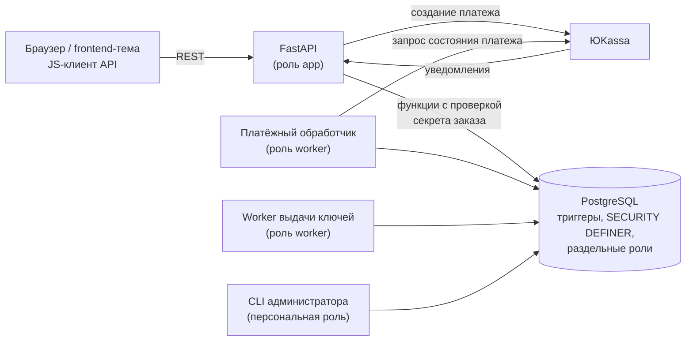

# Digital Store

Backend платформы интернет-магазина цифровых товаров — лицензионных ключей и лицензий на программное обеспечение — с расширяемым ядром для физических товаров и услуг. Python, FastAPI, PostgreSQL.

> **Статус проекта.** В активной разработке. Проект **не развёрнут в production и не принимает реальные платежи**: платёжная интеграция с ЮKassa по умолчанию выключена и проверена против локального имитатора протокола, а не на настоящем магазине. Аккаунты покупателей находятся в разработке и в текущую версию не входят. Подробнее — в разделе [«Ограничения»](#ограничения-текущей-версии).

## О проекте

Digital Store задуман как переиспользуемая основа для небольших интернет-магазинов: каждый клиент получает отдельную установку, а frontend-тема подключается через REST API. Основной сценарий текущей версии — продажа цифровых ключей. Покупатель оформляет заказ без регистрации, оплачивает его, после чего система автоматически выдаёт зашифрованные ключи по секретной ссылке заказа.

Главный акцент проекта — **корректность денег и данных при сбоях и конкурентном доступе**. Критичные инварианты (оплата, остатки, выдача ключей, история) защищены на уровне PostgreSQL, а не только кодом приложения.

## Возможности текущей версии

- **Коммерческое ядро.**
  - Типы товаров: ключи, файлы, физические товары, услуги.
  - Учёт остатка — для каждого товара по выбору.
  - Деньги хранятся в целых минимальных единицах вместе с валютой.
  - Многопозиционные заказы со снимком цен: цены и итог считает сервер.
- **API v1 и v2.** v1 — прежний контракт без изменений. v2 — заказы с секретом доступа (`access_token`), оплата, статус и выдача.
- **Платежи ЮKassa**:
  - checkout по секрету заказа;
  - уведомления складываются в долговременную очередь;
  - оплата учитывается только по состоянию, которое сервер сам получил от провайдера;
  - денежная операция и проведение заказа фиксируются в одной транзакции;
  - есть сверка и восстановление после сбоев;
  - по умолчанию выключено, боевой режим включается только явным подтверждением.
- **Автоматическая выдача цифровых ключей**:
  - ключи хранятся в зашифрованном виде (AES-256-GCM) с версиями ключей шифрования и реестром проверочных значений;
  - товар продаётся только при наличии свободных ключей;
  - выдачу выполняет отдельный worker без доступа к секретам шифрования;
  - импорт и администрирование — через CLI под персональной учётной записью администратора.
- **Раздельные роли PostgreSQL.** Веб-приложение, платёжный обработчик и администраторы работают под разными ролями. Приложение физически не может изменить статус заказа, остатки или финансовую историю: такие изменения возможны только через проверенные `SECURITY DEFINER`-функции.
- **Защита HTTP-слоя.** Ограничение частоты и размера запросов, строгий список разрешённых источников CORS, закрытый публичный список заказов.
- **Frontend Bridge.** Независимый JavaScript-клиент API и демо-витрина на HTML, CSS и JS. Основной frontend разрабатывается отдельно.
- **Миграции.** Собственная система SQL-миграций: журнал применённых изменений, контрольные суммы, весь запуск — одна транзакция.

## Архитектура



Ключевые решения:

- **Схема только через миграции.** `migrations/` — единственный источник истины. `schema.sql` — справочный снимок, его совпадение с миграциями проверяют тесты.
- **Права на уровне базы.** Изменения статусов, денег и выдачи — только через функции `SECURITY DEFINER`. У этих функций закреплён `search_path`, а у `PUBLIC` отозвано право `EXECUTE`. Защитные триггеры не дают переписать историю даже владельцу таблиц.
- **Фоновые процессы отделены от веб-процесса.** Платёжный обработчик и worker выдачи запускаются как отдельные процессы со своими учётными данными.
- **Явный порядок блокировок** во всех конкурентных путях: оплата, назначение ключей, импорт, отмена. Отсутствие взаимоблокировок и двойной выдачи проверяется конкурентными тестами на настоящем PostgreSQL.

Подробное устройство — в [COMMERCE_CORE.md](COMMERCE_CORE.md), [PAYMENTS.md](PAYMENTS.md), [DIGITAL_KEYS.md](DIGITAL_KEYS.md), [DB_ROLES.md](DB_ROLES.md).

## Безопасность

- **Секреты не хранятся в репозитории.** Конфигурация берётся из окружения (`.env` исключён из Git; пример без значений — [`.env.example`](.env.example)). Ключи шифрования цифровых ключей можно держать в отдельном файле, доступном только нужным процессам.
- **Секрет доступа к заказу.** Покупатель получает его один раз, в базе хранится только SHA-256. Без секрета чужой заказ нельзя ни посмотреть, ни оплатить, ни получить по нему ключи.
- **Платёжные уведомления не принимаются на веру.** Состояние платежа обработчик запрашивает у провайдера сам и сверяет сумму и валюту. Ссылки оплаты допускаются только на разрешённые домены, TLS проверяется по системному хранилищу сертификатов.
- **Выдача ключей:**
  - шифрование AES-256-GCM с версионированием ключей;
  - worker отказывается запускаться, если ему переданы секреты шифрования;
  - администраторские функции проверяют членство в группе администраторов на стороне базы.
- **Минимальные права ролей PostgreSQL.** Соблюдение модели прав автоматически проверяется в CI (см. ниже).
- **Ограничение нагрузки.** Лимиты частоты и размера запросов; учитываются только доверенные прокси.

Найденные ограничения безопасности перечислены открыто в разделе [«Ограничения»](#ограничения-текущей-версии) и в профильных документах.

## Технологии

| Слой | Используется |
|---|---|
| Язык | Python 3.14 (версия CI) |
| Веб-фреймворк | FastAPI, Starlette, Uvicorn, Pydantic |
| База данных | PostgreSQL 16+ (CI — PostgreSQL 18), psycopg 3 |
| Платежи | ЮKassa (HTTP API через httpx, `truststore`) |
| Криптография | `cryptography` (AES-256-GCM); HMAC-отпечатки — стандартная библиотека Python |
| Тесты | pytest; JS-клиент — тесты в браузере или Node.js |
| CI | GitHub Actions, одноразовый контейнер PostgreSQL 18 |

## Тесты и CI

- В репозитории более 450 тестовых функций: API, ядро заказов, деньги, платежи (с локальным имитатором протокола ЮKassa), выдача ключей, конкурентность, миграции и права PostgreSQL под настоящими ролями.
- Интеграционные тесты работают только с отдельной базой `*_test`. Предохранитель в `tests/conftest.py` запрещает подключение к любой другой базе.
- Конфигурация CI ([`.github/workflows/ci.yml`](.github/workflows/ci.yml), описание — [CI.md](CI.md)):
  1. поднимает одноразовый PostgreSQL 18;
  2. готовит базу по модели раздельных ролей;
  3. запускает весь набор тестов и требует не менее 780 успешных проверок без пропусков;
  4. сверяет модель безопасности базы (владельцы объектов, `search_path`, права `PUBLIC`, неизменность прав после тестов).
- Workflow запускается на `pull_request`, `push` и вручную, работает с правами только на чтение и не использует секреты репозитория.

Зелёные тесты подтверждают описанное поведение, но не означают готовности к коммерческому запуску.

## Локальный запуск (Windows, PowerShell)

Требования: Python 3.14 (как в CI), PostgreSQL 16 или новее.

**1. Зависимости**

```powershell
python -m venv .venv
.\.venv\Scripts\python.exe -m pip install -r requirements.txt
```

`requirements.txt` хранится в UTF-8. Не пересоздавайте его через `pip freeze > requirements.txt` в Windows PowerShell 5 — получится UTF-16. Правильно так: `pip freeze | Out-File -Encoding utf8 requirements.txt`.

**2. Настройки.** Скопируйте [`.env.example`](.env.example) в `.env` и заполните подключение к базе. Платежи и выдача ключей по умолчанию выключены. Файл `.env` не должен попадать в Git.

**3. Базы данных.** Нужны рабочая база (например, `digital_store`) и отдельная тестовая; имя тестовой обязано оканчиваться на `_test`:

```sql
CREATE DATABASE digital_store;
CREATE DATABASE digital_store_test;
```

**4. Миграции.** Схема устанавливается только через `migrate.py`, имя базы всегда указывается явно:

```powershell
.\.venv\Scripts\python.exe migrate.py status --database digital_store_test   # ничего не меняет
.\.venv\Scripts\python.exe migrate.py apply  --database digital_store_test
```

Как устроены миграции:
- для базы, имя которой не оканчивается на `_test`, нужно подтверждение `--confirm-database <имя>`; перед этим сделайте резервную копию;
- весь запуск — одна транзакция: применяется всё или ничего;
- изменённый уже применённый файл обнаруживается по контрольной сумме;
- исправления вносятся только новой миграцией.

**5. Демо-данные** — только для разработки и тестов: `seed.sql` добавляет несколько демонстрационных товаров без ключей.

```powershell
psql -U postgres -d digital_store_test -f seed.sql
```

**6. Backend**

```powershell
.\.venv\Scripts\python.exe -m uvicorn api:app --reload
```

API — http://127.0.0.1:8000, Swagger — http://127.0.0.1:8000/docs. `--reload` предназначен только для локальной разработки.

Фоновые процессы — по необходимости, см. [PAYMENTS.md](PAYMENTS.md) и [DIGITAL_KEYS.md](DIGITAL_KEYS.md):

```powershell
.\.venv\Scripts\python.exe -m payments.worker --interval 10
.\.venv\Scripts\python.exe -m commerce.fulfillment_worker --interval 10
```

**7. Демо-витрина и тесты JS-клиента**

```powershell
.\.venv\Scripts\python.exe frontend\serve.py
```

Демо-витрина — http://127.0.0.1:5500/examples/vanilla-storefront/, тесты JS-клиента — http://127.0.0.1:5500/tests/ (или `node frontend\tests\run-node.mjs` с Node.js 22.7+). Не раздавайте корень проекта через `python -m http.server`: так станет доступен `.env`.

**8. Тесты**

Тесты не должны читать `.env`: все параметры задаются явно, а `PYTHON_DOTENV_DISABLED=1` отключает python-dotenv. База — только **новая** отдельно согласованная одноразовая база `*_test`, имя которой задано явно в `TEST_DB_NAME`; существующие базы (`digital_store`, `digital_store_test`, `digital_store_roles_test` и другие прежние) для тестов не использовать. Пароль — скрытым вводом, не из `.env`:

```powershell
$env:PYTHON_DOTENV_DISABLED = "1"
$env:TEST_DB_NAME = "<новая_одноразовая_база>_test"
$env:DB_HOST = "localhost"; $env:DB_PORT = "5432"; $env:DB_USER = "<тестовая_роль>"
$env:PGPASSWORD = [Runtime.InteropServices.Marshal]::PtrToStringAuto([Runtime.InteropServices.Marshal]::SecureStringToBSTR((Read-Host "Пароль" -AsSecureString)))
.\.venv\Scripts\python.exe -m pytest tests -q
Remove-Item Env:PGPASSWORD
```

Перед запуском в тестовой базе должны быть применены миграции и `seed.sql`.

**Без `TEST_DB_NAME` пропускаются не все тесты с базой.** Сами себя пропускают только модули аккаунтов с настоящей базой (`test_account_*_db.py`, `test_customer_auth_invariants_db.py`). Остальные тесты с базой (миграции, заказы, платежи, ключи, `test_migration_0005.py`, `test_customer_auth_concurrency.py` и др.) получают отказ предохранителя `tests/conftest.py` ещё до обращения к сети — это ошибка теста, а не пропуск. Базы по умолчанию нет. Поэтому `pytest tests` без явного `TEST_DB_NAME` даёт ошибки у тестов с базой; офлайн-проверки запускайте явно перечисленными модулями без базы.

Предохранитель в `tests/conftest.py`:
- работает только с базой, явно заданной в `TEST_DB_NAME` (имя оканчивается на `_test`); без неё или с пустым значением любое подключение отклоняется;
- отклоняет подключение к любой другой базе;
- перехватывает только `psycopg.connect`, через который подключаются `database.py` и тесты. Прямые `psycopg.Connection.connect` и `psycopg.AsyncConnection.connect`, а также дочерние процессы Python он не контролирует.

Это программная страховка, а не изоляция: надёжнее запускать тесты под отдельной ролью PostgreSQL без доступа к рабочей базе.

Тесты прав PostgreSQL создают временные роли. Поэтому они выполняются только с `DS_TEST_CREATE_ROLES=1` и правом `CREATEROLE` (см. [DB_ROLES.md](DB_ROLES.md)), иначе пропускаются. Как воспроизвести проверки CI локально — [CI.md](CI.md).

## Основные маршруты API

| Метод | Адрес | Назначение |
|---|---|---|
| GET | `/products`, `/api/v2/products` | Каталог: товары в продаже |
| GET | `/products/{id}`, `/api/v2/products/{id}` | Товар по ID (`404`, если нет или снят с продажи) |
| POST | `/orders` | Заказ API v1 в статусе `pending` |
| GET | `/orders` | Публичный список заказов закрыт (`403`) |
| POST | `/api/v2/orders` | Заказ v2 и секрет доступа `access_token` |
| POST | `/api/v2/orders/{id}/checkout` | Начать оплату (нужен `access_token`) |
| POST | `/api/v2/orders/{id}/status` | Статус заказа, оплаты, исполнения и возврата (нужен `access_token`) |
| POST | `/api/v2/orders/{id}/delivery` | Цифровые ключи оплаченного заказа (нужен `access_token`) |
| POST | `/api/v2/payments/yookassa/webhook` | Уведомления ЮKassa (только постановка в очередь) |

Контракты — [FRONTEND_API.md](FRONTEND_API.md) и [FRONTEND_DELIVERY_API.md](FRONTEND_DELIVERY_API.md). Подключение frontend — [FRONTEND_INTEGRATION.md](FRONTEND_INTEGRATION.md).

## Ограничения текущей версии

- **Платежи.** Проверены только против локального имитатора протокола ЮKassa. Нет проверки на тестовом магазине ЮKassa, чеков 54-ФЗ и исполнения возвратов через API. Если при оплате товара не хватает, заказ получает статус `requires_action`, и решение принимает человек.
- **Резервирование.** Его нет: несколько неоплаченных заказов могут претендовать на последнюю единицу товара.
- **Исполнение заказов.** Есть только автоматическая выдача цифровых ключей. Файлов, доставки и задач исполнителям пока нет.
- **Аккаунты и администрирование.** Аккаунты покупателей реализованы (PR6), но **выключены по умолчанию** и не предназначены для публичного включения, пока нет подтверждения email и восстановления пароля ([ACCOUNTS.md](ACCOUNTS.md)). Нет отмены заказа покупателем и админ-API. Администрирование — через SQL-функции и CLI.
- **Ограничение частоты запросов** хранится в памяти процесса; для публичного сервера нужен ещё лимит на обратном прокси.
- **CORS** по умолчанию разрешает только локальные адреса разработки.

Перед публичным запуском нужно довести и проверить платежи, развёртывание, резервное копирование и восстановление.

## В разработке

- **Аккаунты покупателей:** регистрация, вход, сессии, смена пароля, история заказов и привязка новых заказов к аккаунту. Слой базы данных и HTTP API `/api/account/*` реализованы и **выключены по умолчанию** (`DS_ACCOUNTS_ENABLED` и флаги в базе); регистрация закрыта отдельным флагом. Гостевые покупки по секрету заказа сохраняются. До публичного включения нужны подтверждение email и восстановление пароля — см. [ACCOUNTS.md](ACCOUNTS.md) и [FRONTEND_ACCOUNTS_API.md](FRONTEND_ACCOUNTS_API.md).
- **Основной frontend** магазина — разрабатывается отдельно и подключается через описанный REST API.

## Документация

| Документ | Содержание |
|---|---|
| [COMMERCE_CORE.md](COMMERCE_CORE.md) | Устройство ядра: товары, деньги, заказы, оплата, исполнение |
| [PAYMENTS.md](PAYMENTS.md) | Архитектура платежей, статусы, сбои и восстановление, настройка |
| [DIGITAL_KEYS.md](DIGITAL_KEYS.md) | Выдача ключей: шифрование, импорт, резервные копии, эксплуатация |
| [DB_ROLES.md](DB_ROLES.md) | Раздельные роли PostgreSQL и пошаговый переход на них |
| [FRONTEND_API.md](FRONTEND_API.md) | Контракт REST API (v1 и v2) |
| [FRONTEND_DELIVERY_API.md](FRONTEND_DELIVERY_API.md) | Контракт получения цифровых ключей |
| [FRONTEND_ACCOUNTS_API.md](FRONTEND_ACCOUNTS_API.md) | Контракт аккаунтов покупателей (выключены по умолчанию) |
| [ACCOUNTS.md](ACCOUNTS.md) | Аккаунты: включение, секреты, сессии, ограничения эксплуатации |
| [FRONTEND_INTEGRATION.md](FRONTEND_INTEGRATION.md) | Подключение frontend, CORS, демо-витрина |
| [CI.md](CI.md) | Что проверяет CI и как повторить проверки локально |

## Структура проекта

```text
digital-store/
├── api.py                 # FastAPI-приложение и маршруты (api:app)
├── database.py            # подключение к PostgreSQL, каталог и заказы API v1
├── commerce/              # ядро: деньги, каталог, заказы, исполнение, выдача цифровых ключей
├── payments/              # платежи: провайдер, адаптер ЮKassa, сервис, обработчик
├── http_security.py       # ограничение частоты и размера запросов
├── cors_settings.py       # разрешённые frontend-адреса
├── migrate.py             # система миграций (status / apply)
├── migrations/            # SQL-миграции — единственный источник истины для схемы
├── schema.sql             # справочный снимок схемы (сверяется с миграциями)
├── seed.sql               # демонстрационные товары (только разработка и тесты)
├── deploy/db_roles.py     # SQL раздельных ролей PostgreSQL (печатает, не применяет)
├── ci/                    # подготовка тестовой базы и проверки модели безопасности в CI
├── tests/                 # pytest: API, ядро, платежи, выдача, конкурентность, миграции, права
├── frontend/              # JS-клиент API, демо-витрина, тесты клиента
└── .env.example           # пример настроек без секретов
```

## Команда и лицензия

Проект разрабатывают два участника: backend (этот репозиторий) и frontend (разрабатывается отдельно).

Лицензия пока не выбрана. Пока файл лицензии не добавлен, все права на код принадлежат авторам: просматривать код можно, а для использования, копирования и распространения нужно разрешение авторов.
